<p align="center">
  <a href="README.md"></a>
  <a href="README.en.md"></a>
</p>

<div align="center">
  

  # Codex-X

  **Codex Prompts · API / Providers · Sessions · Skills / MCP in One Place**

  A cross-platform desktop tool for **OpenAI Codex Desktop / Codex CLI**. Manage prompt templates, switch third-party APIs, organize / repair / permanently delete local sessions, manage Skills / MCP, and inspect TOML and login credentials without repeatedly editing configuration files by hand.

  <p>
    <a href="https://github.com/antonkomarev/github-trending-archive/blob/80b65ba24e649d0a2ce2c6bad776ce1284312a4a/archive/repository/2026/2026-09-22/%28null%29.json" title="No. 12 on GitHub Trending worldwide (2026-09-22)"></a>
    &nbsp;
    <a href="https://trendshift.io/repositories/104938"></a><br />
    <sub><a href="https://github.com/antonkomarev/github-trending-archive/blob/aeea175a90b86aba1844727221cf2aaa8decd908/archive/repository/2026/2026-09-20/rust.json">Rust daily #2 · Sep 20, 2026</a> · <a href="https://github.com/hanishrao/trending-collection/blob/5e670f30866729b5a3b2c8e550836cca5f69de98/api/weekly/rust.json#L19">Rust weekly #2 · Sep 27, 2026</a></sub>
  </p>

  <p>
    
    
    
    
  </p>

  <p>
    
    
    
    
    
  </p>
</div>

---

## What is Codex-X?

When you use Codex Desktop, the CLI, third-party APIs, and multiple prompts together, settings quickly become scattered across different files. Codex-X brings these frequent tasks into one desktop interface, so you can see the current state and complete common actions with a click.

You can use it to:

- Choose from the prompt library or import your own `.md`, then keep the existing prompt or replace it
- Manage multiple named official Codex login profiles and third-party APIs, duplicate or switch them with a click, and import Providers from cc-switch
- Search and organize local sessions by project, check / automatically repair problems, and precisely delete sessions you no longer need
- Manage Skills and MCP in one place, and inspect the current `config.toml`, `auth.json`, and operation backups
- Explore token usage by date and model in Settings, with subagent usage attributed to its main conversation

## Preview

These screenshots show Codex-X v0.3.35 with the Atlas Studio demo workspace. Select an image to view it at full size.

<p align="center">
  <a href="docs/screenshots/app/v0.3.35/en/sessions.webp">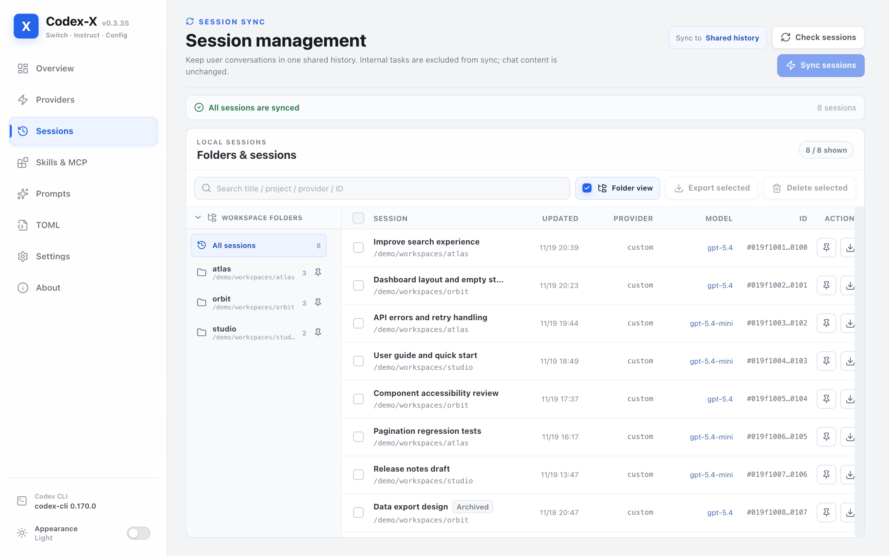</a><br />
  <b>Sessions</b> · Browse conversations by project folder
</p>

<table>
  <tr>
    <td width="50%" valign="top">
      <a href="docs/screenshots/app/v0.3.35/en/overview.webp">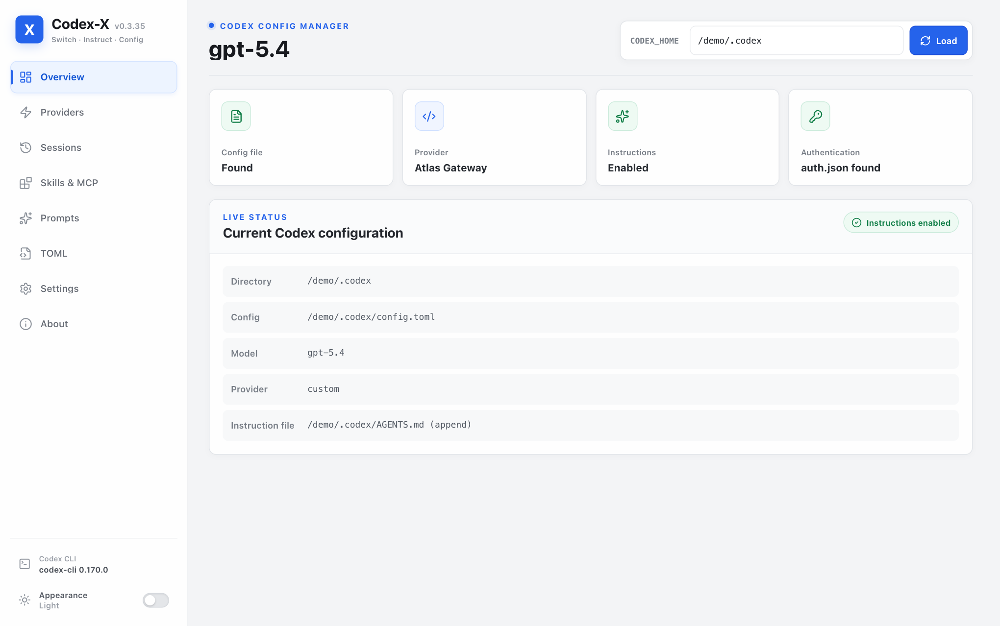</a><br />
      <b>Overview</b><br />
      <sub>See the active model, provider, and configuration directory</sub>
    </td>
    <td width="50%" valign="top">
      <a href="docs/screenshots/app/v0.3.35/en/providers.webp">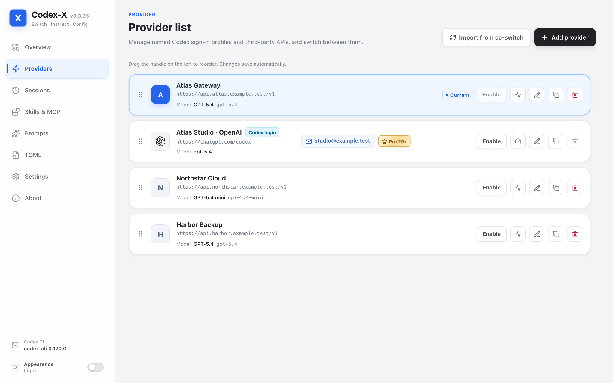</a><br />
      <b>Providers</b><br />
      <sub>Manage official accounts and third-party APIs</sub>
    </td>
  </tr>
  <tr>
    <td width="50%" valign="top">
      <a href="docs/screenshots/app/v0.3.35/en/prompts.webp">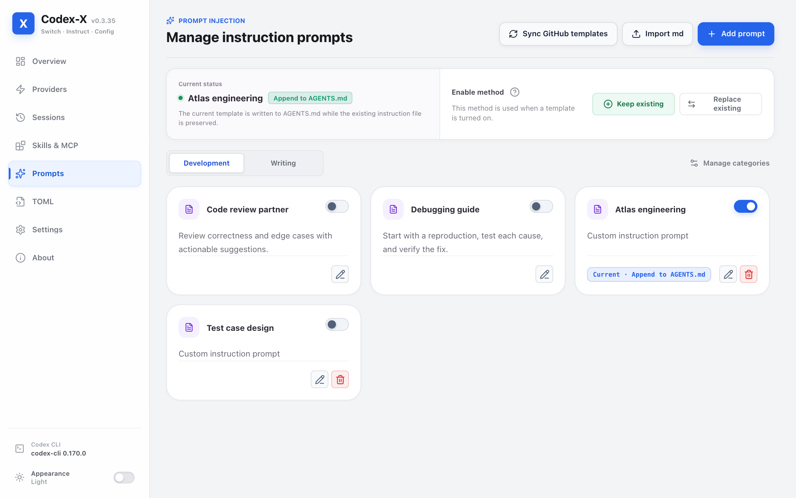</a><br />
      <b>Prompts</b><br />
      <sub>Organize templates and enable a prompt</sub>
    </td>
    <td width="50%" valign="top">
      <a href="docs/screenshots/app/v0.3.35/en/usage.webp">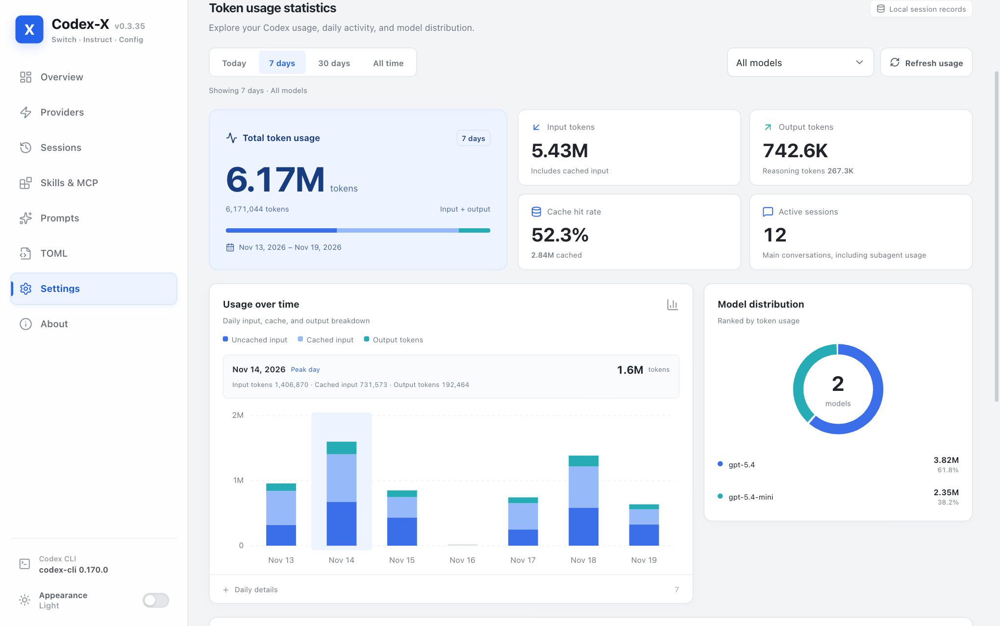</a><br />
      <b>Usage statistics</b><br />
      <sub>Explore seven days of token usage by model</sub>
    </td>
  </tr>
</table>

<details>
<summary><b>Show Skills, MCP, TOML, routing, settings, and About</b></summary>

<table>
  <tr>
    <td width="50%" valign="top">
      <a href="docs/screenshots/app/v0.3.35/en/skills.webp">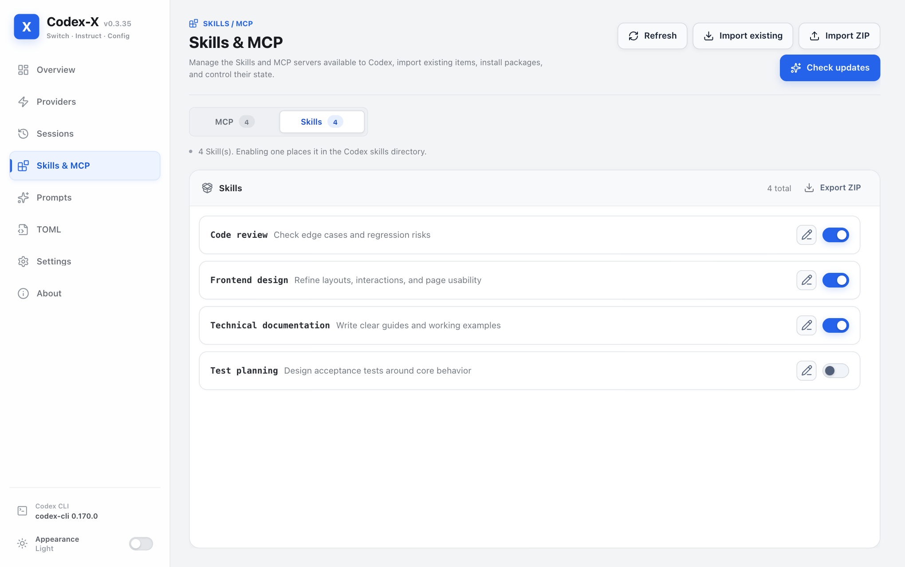</a><br />
      <b>Skills</b><br />
      <sub>Browse and enable workspace skills</sub>
    </td>
    <td width="50%" valign="top">
      <a href="docs/screenshots/app/v0.3.35/en/mcp.webp">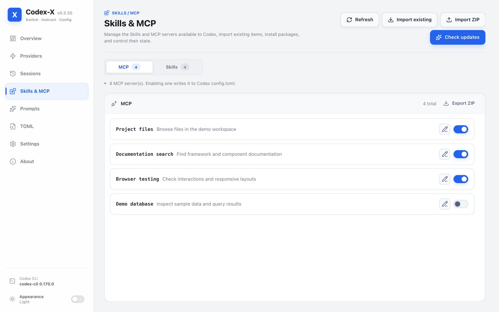</a><br />
      <b>MCP</b><br />
      <sub>Manage local and remote MCP servers</sub>
    </td>
  </tr>
  <tr>
    <td width="50%" valign="top">
      <a href="docs/screenshots/app/v0.3.35/en/toml.webp">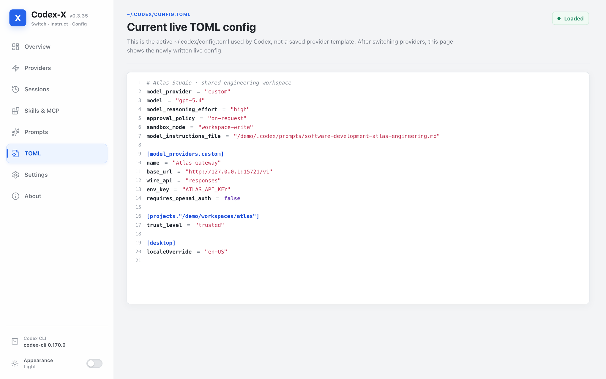</a><br />
      <b>TOML</b><br />
      <sub>Inspect the active configuration</sub>
    </td>
    <td width="50%" valign="top">
      <a href="docs/screenshots/app/v0.3.35/en/routing.webp">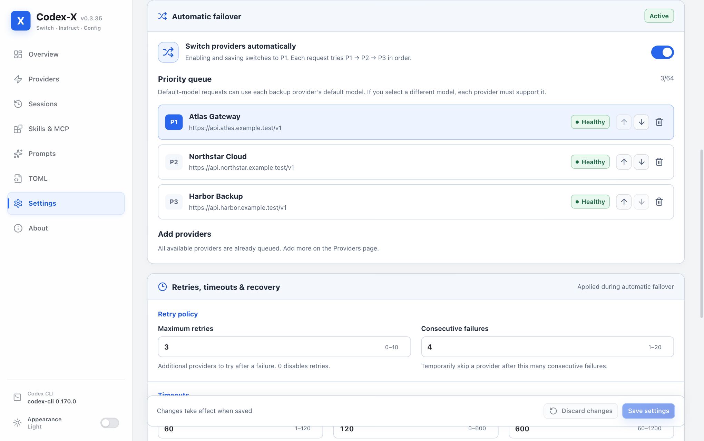</a><br />
      <b>Routing &amp; failover</b><br />
      <sub>See provider priority and failover status</sub>
    </td>
  </tr>
  <tr>
    <td width="50%" valign="top">
      <a href="docs/screenshots/app/v0.3.35/en/settings.webp">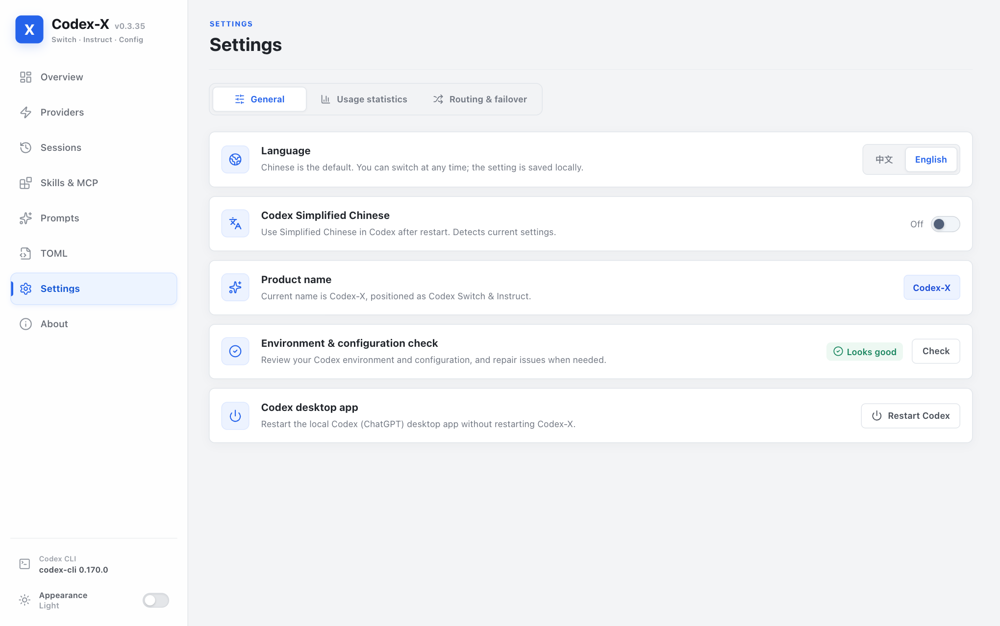</a><br />
      <b>General settings</b><br />
      <sub>Choose the interface language and check the environment</sub>
    </td>
    <td width="50%" valign="top">
      <a href="docs/screenshots/app/v0.3.35/en/about.webp">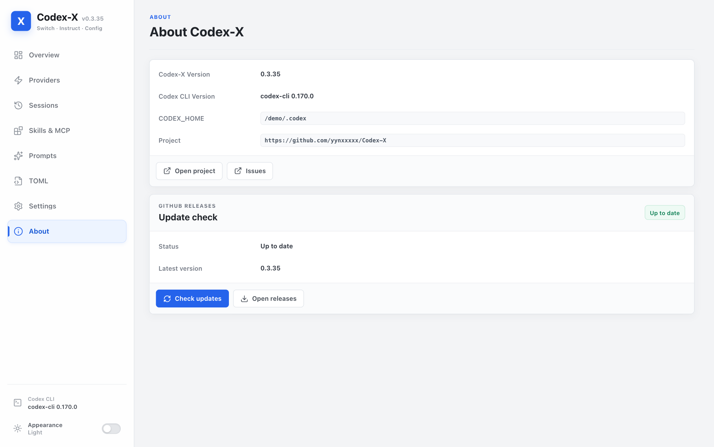</a><br />
      <b>About</b><br />
      <sub>Check the installed version and update status</sub>
    </td>
  </tr>
</table>

</details>

## Features

<div align="center">
<table>
  <tr>
    <th align="center" width="190">What you want to do</th>
    <th align="center">How Codex-X helps</th>
  </tr>
  <tr>
    <td align="center">🧩 <b>Use prompt templates</b></td>
    <td align="left">The current library contains <b>5 templates</b>. Enable / disable one with a click and choose “Keep existing” or “Replace existing”; GitHub sync, local caching, and importing or editing your own <code>.md</code> files are supported.</td>
  </tr>
  <tr>
    <td align="center">⚡ <b>Switch APIs / relays</b></td>
    <td align="left">Save multiple named official Codex login profiles alongside third-party Providers, with one-click duplication and switching. Third-party Providers support connection checks, model discovery / testing, and imports from cc-switch.</td>
  </tr>
  <tr>
    <td align="center">💬 <b>Organize local sessions</b></td>
    <td align="left">Search sessions, group them by project path, and check or automatically repair inconsistent data. Select one, several, or an entire project to permanently delete specific sessions from Codex storage.</td>
  </tr>
  <tr>
    <td align="center">🧠 <b>Manage Skills / MCP</b></td>
    <td align="left">View available Skills and MCP servers, preview existing items before import, install a Skill from ZIP, enable / disable individual entries, and check Skill update status.</td>
  </tr>
  <tr>
    <td align="center">📝 <b>Manage config and login</b></td>
    <td align="left">Inspect <code>config.toml</code> and <code>auth.json</code> in one place. Both official and third-party profile editors offer an “Enable 1M context window” checkbox beside <code>config.toml>; it applies on save and requires model support. Important writes are backed up automatically.</td>
  </tr>
  <tr>
    <td align="center">📊 <b>Track token usage</b></td>
    <td align="left">Switch between General and Usage statistics in Settings. Filter local usage by date and model, explore daily trends, cache hit rate, and model distribution, and view the 10 most recent main conversations. Subagent usage is attributed to its main conversation and does not count as a separate session.</td>
  </tr>
  <tr>
    <td align="center">📦 <b>Use it across platforms</b></td>
    <td align="left">Available for macOS Apple Silicon / Intel, Windows MSI / portable, and Linux packages. Installed editions can download, verify, and install updates in the app; the portable edition keeps manual downloads.</td>
  </tr>
</table>
</div>

## Community

Scan either code with QQ to join an AI technology discussion group.

<div align="center">
  <table>
    <tr>
      <td align="center"><b>QQ discussion group 1</b><br /><a href="docs/community/qq-group-1.png"></a></td>
      <td align="center"><b>QQ discussion group 2</b><br /><a href="docs/community/qq-group-2.png"></a></td>
    </tr>
  </table>
</div>

## Highlights

### 1. Prompt Template Center

<p align="center">
  
  
  
</p>

> [!TIP]
> **Ready after installation, automatically expanded when online.**
>
> The app bundle includes 5 templates for offline use. After launch, it synchronizes 6 additional software-development and writing templates, plus later updates, from GitHub `examples/` in the background without waiting for the **Prompt** page to open. Successfully synchronized online versions are cached locally and remain available during temporary network outages.

<div align="center">
<table>
  <tr>
    <th align="center">Template</th>
    <th align="center">Best for</th>
    <th align="center">Availability</th>
  </tr>
  <tr>
    <td><a href="examples/software-development-maintainer.md"><code>software-development-maintainer.md</code></a></td>
    <td align="left">Long-term maintenance with reuse, minimal changes, safety, testing, and maintainability</td>
    <td align="center">GitHub sync</td>
  </tr>
  <tr>
    <td><a href="examples/software-development-debugging.md"><code>software-development-debugging.md</code></a></td>
    <td align="left">Evidence-driven debugging from reliable reproduction to root-cause repair and regression checks</td>
    <td align="center">GitHub sync</td>
  </tr>
  <tr>
    <td><a href="examples/software-development-code-review.md"><code>software-development-code-review.md</code></a></td>
    <td align="left">Severity-ranked review of defects, regressions, security risks, and test gaps</td>
    <td align="center">GitHub sync</td>
  </tr>
  <tr>
    <td><a href="examples/writing-clarity-editor.md"><code>writing-clarity-editor.md</code></a></td>
    <td align="left">Chinese and English editing that preserves the author's meaning and facts</td>
    <td align="center">GitHub sync</td>
  </tr>
  <tr>
    <td><a href="examples/writing-technical-docs.md"><code>writing-technical-docs.md</code></a></td>
    <td align="left">Source-grounded README, guide, API, architecture, and release documentation</td>
    <td align="center">GitHub sync</td>
  </tr>
  <tr>
    <td><a href="examples/writing-structured-draft.md"><code>writing-structured-draft.md</code></a></td>
    <td align="left">Turns scattered material into a structured report, proposal, retrospective, or article draft</td>
    <td align="center">GitHub sync</td>
  </tr>
</table>
</div>

<table>
  <tr>
    <td width="50%" valign="top">
      <b>Keep existing prompt</b><br />
      Best for users who already have personal rules. Codex-X only appends its managed content and removes only that content when disabled, leaving the original prompt untouched.
    </td>
    <td width="50%" valign="top">
      <b>Replace existing prompt</b><br />
      Makes the selected template the primary instruction entry point, which is useful when you want to switch completely to a specific template.
    </td>
  </tr>
</table>

A backup is created automatically before every enable or disable action. In addition to the template library, you can import, edit, and delete your own `.md` prompts.

### 2. Provider Switching: Ready in a New Session

> [!NOTE]
> After enabling a new third-party Provider, create or reopen a Codex session to use the new relay. You do not need to restart the entire Codex client.

- Save multiple named official Codex login profiles and third-party Providers, and always see which one is currently active
- Duplicate a profile immediately with one click, without a confirmation dialog or opening the editor; rename it whenever needed
- Test an API endpoint before switching, and save or enable a configuration separately
- Edit the Base URL, API Key, Model, Wire API, and complete TOML on the same page
- cc-switch imports report added, updated, merged, and skipped entries; the same URL + Key is no longer shown more than once
- Switching back to OpenAI Official preserves the current official login, and third-party configurations no longer disappear unexpectedly

### 3. Official Auth management

- Automatically read Codex official `auth.json`
- View / edit ChatGPT login-state Auth
- Distinguish official Auth from third-party API Keys
- Manage official Auth and third-party Providers in one UI

### 4. Visual TOML editing

- View the current Codex `config.toml`
- Dark code preview with syntax highlighting
- Edit full TOML directly from the Provider editor
- Save changes back to the Codex configuration directory

### 5. Session Management: Inspect, Repair, and Permanently Delete

The session list shows saved names. Hover over a row to preview the first user prompt. On Windows, select the WSL `.codex` directory and click **Check sessions** to browse or export existing conversations. [WSL session guide](docs/WSL_SESSIONS.md)

<table>
  <tr>
    <td width="50%" valign="top">
      <b>Find and organize</b><br />
      Search sessions by title or project path and group them by project. Internal subagent sessions created automatically by Codex stay out of the normal session list by default.
    </td>
    <td width="50%" valign="top">
      <b>Inspect and repair</b><br />
      Check whether local sessions match the current Provider, repair all mismatches manually, or enable automatic inspection and repair at startup.
    </td>
  </tr>
  <tr>
    <td colspan="2" valign="top">
      <b>Precise deletion</b><br />
      Select one session, several sessions, or one or more projects to select all sessions under them. After confirmation, the matching sessions and their derived child sessions are removed from Codex storage itself.
    </td>
  </tr>
</table>

> [!CAUTION]
> **Permanent deletion cannot be undone.** Close any Codex windows or CLI processes still using those sessions, then review the deletion list again in the confirmation dialog.

### 6. Skills / MCP Management

Manage Codex capability extensions from the **Skills & MCP** page instead of searching through multiple directories and configuration files.

<table>
  <tr>
    <td width="50%" valign="top">
      <b>Skills</b><br />
      View current Skills, import existing content, or install from ZIP. Enable / disable entries individually and check whether installed Skills have updates.
    </td>
    <td width="50%" valign="top">
      <b>MCP</b><br />
      Preview existing MCP servers before importing them, then choose what Codex-X should manage. Codex-X maintains the Codex configuration when a server is enabled or disabled.
    </td>
  </tr>
</table>

### 7. Cross-platform desktop app

- macOS Apple Silicon `.dmg`
- macOS Intel `.dmg`
- Windows `.msi`
- Windows Portable `.zip`
- Linux `.deb` / `.rpm` / `.AppImage`
- Automatic GitHub Releases builds
- In-app updates for installed editions; manual updates for Windows Portable

## Tech Stack

| Category | Technology |
| --- | --- |
| Desktop framework | Tauri 2 |
| Frontend | React 18 / TypeScript / Vite |
| Backend | Rust |
| Local data | SQLite / rusqlite |
| Config editing | TOML / JSON |
| Release | GitHub Actions / GitHub Releases |

## Configuration Paths

Codex-X reads the Codex configuration directory by default:

```text
~/.codex/config.toml
~/.codex/auth.json
```

Environment variables are also supported:

```text
CODEX_HOME=/path/to/.codex
CODEXX_HOME=/path/to/codex-x-data
CC_SWITCH_HOME=/path/to/.cc-switch
```

Codex-X's own database is stored by default at:

```text
~/.codexx/codexx.db
```

## Download

Download from the Releases page:

https://github.com/yynxxxxx/Codex-X/releases

## Development

```bash
pnpm install
pnpm dev
```

Build desktop bundles:

```bash
pnpm --dir apps/desktop tauri build
```

## Desktop Installation Notes

The macOS release DMGs are signed and notarized. Choose the Apple Silicon or Intel download for your Mac.

## License

This project is open-sourced under the [MIT License](https://github.com/yynxxxxx/Codex-X/blob/main/LICENSE).

## Thanks

Thanks to the [LINUX DO forum](https://linux.do/) community for attention, feedback, and support.

## Star History

<p align="center">
  <a href="https://github.com/yynxxxxx/Codex-X/stargazers">
    <picture>
      <source media="(prefers-color-scheme: dark)" srcset="https://codex-star-history.zhihack0728.workers.dev/v1/charts/codex-x.svg?theme=dark" />
      <source media="(prefers-color-scheme: light)" srcset="https://codex-star-history.zhihack0728.workers.dev/v1/charts/codex-x.svg?theme=light" />
      
    </picture>
  </a>
</p>
