<p align="center">
  <a href="README.md"></a>
  <a href="README.en.md"></a>
</p>

<div align="center">
  

  # Codex-X

  **Codex 可视化提示词注入 · Provider · 会话 · Skills / MCP 管理工具**

  一款面向 **OpenAI Codex 桌面端 / Codex CLI** 的跨平台桌面工具。把提示词模板、自定义 Prompt、第三方 API 供应商、会话同步、Skills / MCP 和 TOML 配置都放进可视化界面里，不用反复手改文件。

  <p>
    <a href="https://trendshift.io/repositories/104938"></a><br />
    <sub><a href="https://github.com/antonkomarev/github-trending-archive/blob/aeea175a90b86aba1844727221cf2aaa8decd908/archive/repository/2026/2026-09-20/rust.json">Rust 日榜第 2 名 · 2026-09-20</a></sub>
  </p>

  <p>
    
    
    
    
  </p>

  <p>
    
    
    
    
    
  </p>
</div>

---

## Codex-X 是什么？

当你同时使用 Codex 桌面端、CLI、第三方 API、Skills / MCP 和多套提示词时，配置很容易散落在不同文件里。Codex-X 把这些高频操作集中到一个桌面界面中，让当前状态看得见、常用操作点一下就能完成。

你可以用它：

- 像管理插件一样管理提示词：分类、导入 Markdown、自定义编辑、一键启用 / 禁用
- 内置 5 套提示词模板，同时支持用户把自己的提示词变成可视化模板库
- 管理多个可命名的官方 Codex 登录与第三方 API，一键复制、切换，并从 cc-switch 导入现有供应商
- 同步、检查、搜索和删除本地会话，按项目路径整理 Codex 历史记录
- 集中管理 Skills 与 MCP，查看当前 `config.toml`、`auth.json` 和操作备份
- 在设置中按日期、模型查看 Token 用量趋势，子代理用量归入所属主会话

## 软件预览

以下截图来自 Codex-X v0.3.35，使用 Atlas Studio 演示工作区。点击图片可查看原图。

<p align="center">
  <a href="docs/screenshots/app/v0.3.35/zh/sessions.webp">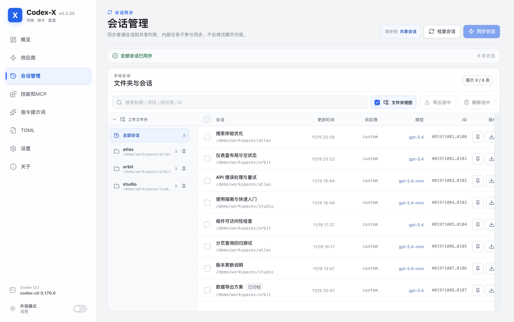</a><br />
  <b>会话管理</b> · 按项目文件夹浏览历史会话
</p>

<table>
  <tr>
    <td width="50%" valign="top">
      <a href="docs/screenshots/app/v0.3.35/zh/overview.webp">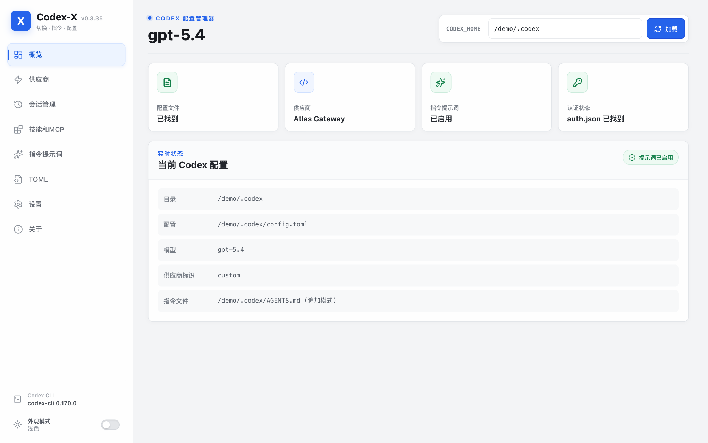</a><br />
      <b>概览</b><br />
      <sub>查看当前模型、供应商和配置目录</sub>
    </td>
    <td width="50%" valign="top">
      <a href="docs/screenshots/app/v0.3.35/zh/providers.webp">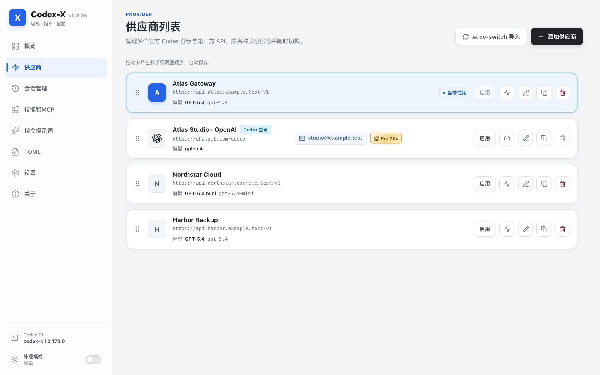</a><br />
      <b>供应商</b><br />
      <sub>管理官方账号和第三方 API</sub>
    </td>
  </tr>
  <tr>
    <td width="50%" valign="top">
      <a href="docs/screenshots/app/v0.3.35/zh/prompts.webp">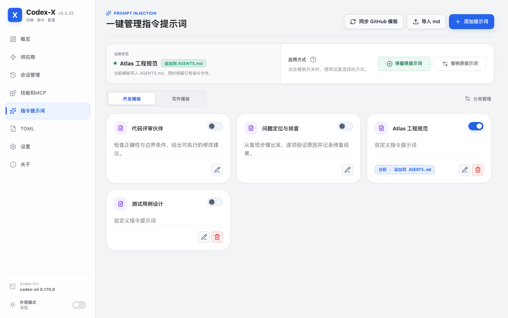</a><br />
      <b>指令提示词</b><br />
      <sub>按分类选择和启用提示词</sub>
    </td>
    <td width="50%" valign="top">
      <a href="docs/screenshots/app/v0.3.35/zh/usage.webp">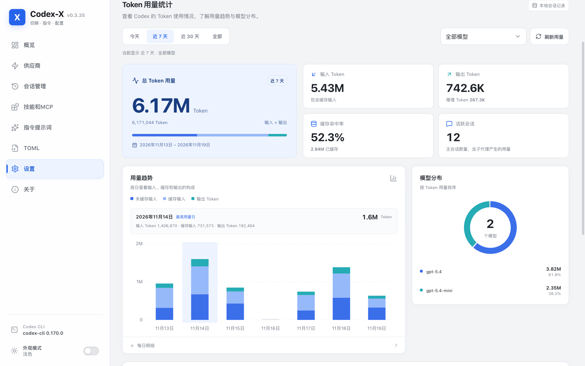</a><br />
      <b>用量统计</b><br />
      <sub>查看近七天的 Token 用量和模型分布</sub>
    </td>
  </tr>
</table>

<details>
<summary><b>展开查看 Skills、MCP、TOML、路由、设置和关于</b></summary>

<table>
  <tr>
    <td width="50%" valign="top">
      <a href="docs/screenshots/app/v0.3.35/zh/skills.webp">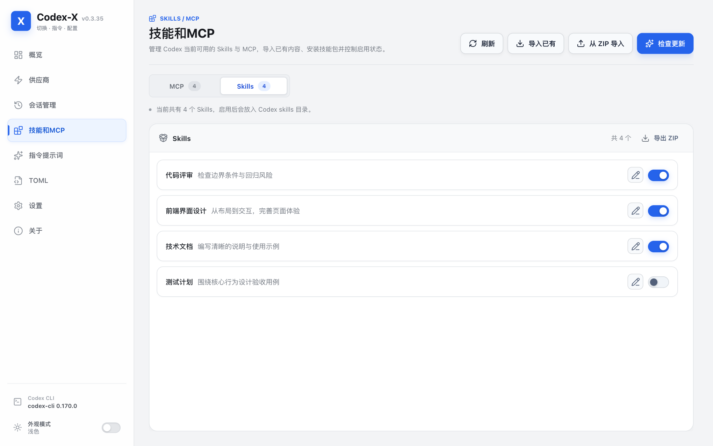</a><br />
      <b>Skills</b><br />
      <sub>查看和启用工作区技能</sub>
    </td>
    <td width="50%" valign="top">
      <a href="docs/screenshots/app/v0.3.35/zh/mcp.webp">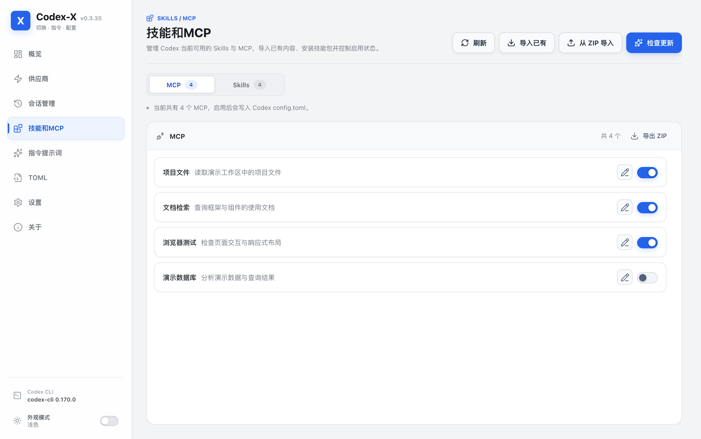</a><br />
      <b>MCP</b><br />
      <sub>管理本地与远程 MCP 服务</sub>
    </td>
  </tr>
  <tr>
    <td width="50%" valign="top">
      <a href="docs/screenshots/app/v0.3.35/zh/toml.webp">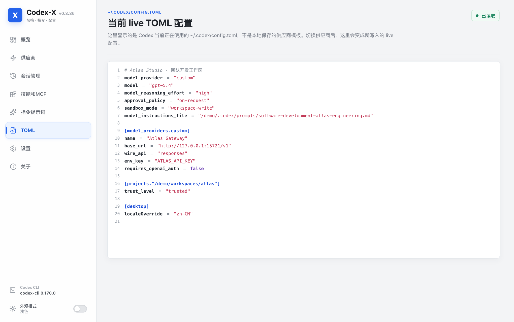</a><br />
      <b>TOML</b><br />
      <sub>查看当前生效的配置</sub>
    </td>
    <td width="50%" valign="top">
      <a href="docs/screenshots/app/v0.3.35/zh/routing.webp">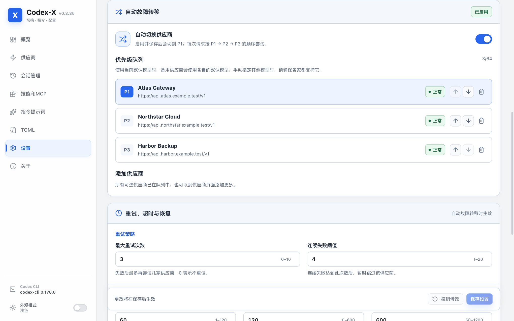</a><br />
      <b>路由与故障转移</b><br />
      <sub>查看主备供应商的优先级和状态</sub>
    </td>
  </tr>
  <tr>
    <td width="50%" valign="top">
      <a href="docs/screenshots/app/v0.3.35/zh/settings.webp">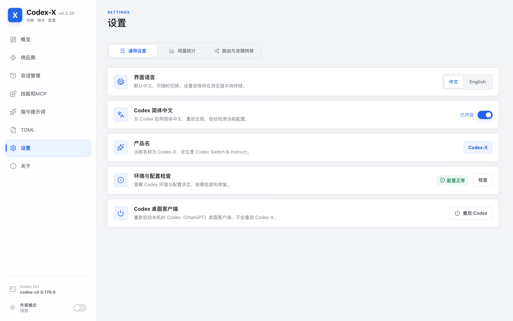</a><br />
      <b>通用设置</b><br />
      <sub>切换语言并查看环境检查结果</sub>
    </td>
    <td width="50%" valign="top">
      <a href="docs/screenshots/app/v0.3.35/zh/about.webp">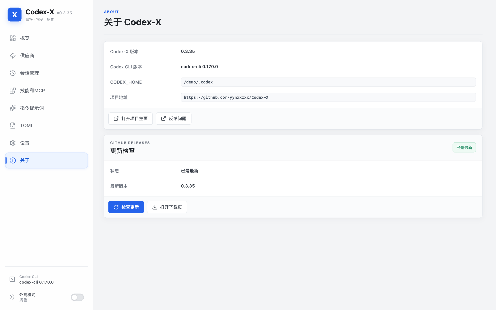</a><br />
      <b>关于</b><br />
      <sub>查看版本和更新状态</sub>
    </td>
  </tr>
</table>

</details>

## 功能特性

<div align="center">
<table>
  <tr>
    <th align="center" width="190">你想做的事</th>
    <th align="center">Codex-X 能帮你</th>
  </tr>
  <tr>
    <td align="center"><b>提示词注入管理</b></td>
    <td align="left">内置 <b>5 套</b>提示词模板，支持分类、GitHub 同步、本地缓存、导入 <code>.md</code>、添加自定义提示词、编辑说明、一键启用 / 禁用。</td>
  </tr>
  <tr>
    <td align="center"><b>启用方式切换</b></td>
    <td align="left">可选择“保留原提示词”追加写入，也可选择“替换原提示词”完整切换；适合在不同模型、不同任务、不同 Prompt 之间快速切换。</td>
  </tr>
  <tr>
    <td align="center"><b>Provider / API</b></td>
    <td align="left">保存多个可命名的官方 Codex 登录配置，与第三方供应商统一管理、一键复制和切换；第三方供应商支持连接检测、模型获取 / 测试及从 cc-switch 导入。</td>
  </tr>
  <tr>
    <td align="center"><b>会话管理</b></td>
    <td align="left">搜索本地会话、按项目路径分组、同步当前供应商、检查会话状态，并支持单选 / 多选 / 项目级永久删除。</td>
  </tr>
  <tr>
    <td align="center"><b>Skills / MCP</b></td>
    <td align="left">可视化查看 Skills 与 MCP，导入已有配置，从 ZIP 安装 Skill，逐项启用 / 禁用，并检查更新状态。</td>
  </tr>
  <tr>
    <td align="center"><b>配置与登录</b></td>
    <td align="left">集中查看 <code>config.toml</code> 与 <code>auth.json</code>；官方登录和第三方供应商编辑页均可在 <code>config.toml</code> 旁勾选“开启 1M 上下文窗口”，保存后生效，需模型支持；重要写入前自动备份。</td>
  </tr>
  <tr>
    <td align="center"><b>用量统计</b></td>
    <td align="left">设置页提供“通用设置 / 用量统计”标签，按日期与模型筛选本地 Token 用量，查看每日趋势、缓存命中率、模型分布及最近 10 个主会话；子代理用量归入所属主会话，不单独计为会话。</td>
  </tr>
  <tr>
    <td align="center"><b>跨平台使用</b></td>
    <td align="left">提供 macOS Apple Silicon / Intel、Windows MSI / 便携版和 Linux 安装包；MSI 安装版可在应用内直接下载、校验并安装更新，便携版继续使用手动下载。</td>
  </tr>
</table>
</div>

## 核心亮点

### 1. 可视化提示词注入中心

<p align="center">
  
  
  
  
</p>

> [!TIP]
> **安装后就能用，联网后自动补齐，也能维护自己的提示词库。**
>
> 安装包离线自带 5 套模板；软件启动后会从 GitHub `examples/` 同步另外 6 套软件开发与写作辅助模板，以及后续更新。同步成功的在线版本会缓存到本地，临时离线仍可继续使用。你也可以导入自己的 `.md`、新增分类、编辑说明，并像切换插件一样启用或禁用任意提示词。

Codex-X 现在不只是“几套内置 Prompt”的启动器，而是一个可视化提示词注入与管理工具：

- 按分类管理提示词，例如软件开发、写作辅助，也可以新增自己的分类
- 支持同步 GitHub 模板、导入 Markdown、手动添加提示词、编辑标题 / 文件名 / 内容
- 每个提示词都有独立开关，打开时自动按当前启用方式写入 Codex 指令文件
- 支持“保留原提示词”和“替换原提示词”两种模式，适合日常叠加或完整切换
- 本地缓存可离线使用，后续模板更新不会影响你自己维护的自定义提示词

<div align="center">
<table>
  <tr>
    <th align="center">模板</th>
    <th align="center">适合场景</th>
    <th align="center">获取方式</th>
  </tr>
  <tr>
    <td><a href="examples/software-development-maintainer.md"><code>software-development-maintainer.md</code></a></td>
    <td align="left">长期维护正式项目，强调复用、最小改动、安全、测试与可维护性</td>
    <td align="center">GitHub 在线同步</td>
  </tr>
  <tr>
    <td><a href="examples/software-development-debugging.md"><code>software-development-debugging.md</code></a></td>
    <td align="left">从稳定复现和证据采集推进到根因修复与回归验证</td>
    <td align="center">GitHub 在线同步</td>
  </tr>
  <tr>
    <td><a href="examples/software-development-code-review.md"><code>software-development-code-review.md</code></a></td>
    <td align="left">按严重级别审查缺陷、回归、安全风险和测试缺口</td>
    <td align="center">GitHub 在线同步</td>
  </tr>
  <tr>
    <td><a href="examples/writing-clarity-editor.md"><code>writing-clarity-editor.md</code></a></td>
    <td align="left">在保留原意和事实的前提下润色中英文表达</td>
    <td align="center">GitHub 在线同步</td>
  </tr>
  <tr>
    <td><a href="examples/writing-technical-docs.md"><code>writing-technical-docs.md</code></a></td>
    <td align="left">基于代码与事实编写 README、指南、API 和发布文档</td>
    <td align="center">GitHub 在线同步</td>
  </tr>
  <tr>
    <td><a href="examples/writing-structured-draft.md"><code>writing-structured-draft.md</code></a></td>
    <td align="left">将零散材料组织成报告、方案、复盘或文章初稿</td>
    <td align="center">GitHub 在线同步</td>
  </tr>
</table>
</div>

<table>
  <tr>
    <td width="50%" valign="top">
      <b>保留原提示词</b><br />
      适合已经有个人规则的用户。Codex-X 只追加自己管理的内容，禁用时也只移除这一部分，不动原有提示词。
    </td>
    <td width="50%" valign="top">
      <b>替换原提示词</b><br />
      将所选模板设为当前主要指令入口，适合希望完整切换到某套模板的用户。
    </td>
  </tr>
</table>

每次启用或禁用前都会自动创建备份。除了模板库，你也可以导入、编辑、删除自己的 `.md` 提示词，并通过分类管理把常用提示词整理成自己的工作流。

> [!NOTE]
> 如果你有好用的提示词模板，欢迎在 [Issues](https://github.com/yynxxxxx/Codex-X/issues) 提交：请附上模板名称、适用场景、Markdown 内容、推荐启用方式和必要说明。合适的模板会考虑收录到 `examples/`，让更多用户可以一键同步使用。

### 2. Provider / API：添加、检测、获取模型、随时切换

> [!NOTE]
> 启用新的第三方供应商后，新建或重新打开 Codex 会话即可使用新的中转，不需要重启整个 Codex 客户端。

- 保存多个可命名的官方 Codex 登录配置与第三方供应商，随时查看当前正在使用哪一个
- 点击“复制”直接新增独立副本，无需确认或进入编辑页；名称可稍后修改
- 切换前可检测连接，并可获取模型进行测试
- 在同一页面编辑 Base URL、API Key、Model、上游接口协议、Headers 和完整 TOML
- 本地路由支持 Responses、Chat Completions、Claude Messages、Gemini 原生接口，使用方式与边界见[供应商协议说明](docs/PROVIDER_PROTOCOLS.md)
- 从 cc-switch 导入时自动区分新增、更新、合并与跳过；相同 URL + Key 不再重复显示
- 切回 OpenAI Official 时保留当前官方登录态，第三方配置也不会凭空消失

### 3. 会话管理：同步、检查与永久删除

会话列表优先显示会话名称，鼠标悬停在会话行上可预览首次提示词。在 Windows 中选择 WSL 的 `.codex` 目录，点击「检查会话」即可查看或导出已有会话。[WSL 会话使用说明](docs/WSL_SESSIONS.md)

<table>
  <tr>
    <td width="50%" valign="top">
      <b>同步和检查</b><br />
      检查本地会话是否和当前 Provider / 模型一致，需要时一键同步到当前供应商配置，不修改聊天内容。
    </td>
    <td width="50%" valign="top">
      <b>查找和整理</b><br />
      按标题、项目路径、供应商或 ID 搜索会话，也可以按项目路径分组查看，适合清理长期使用后积累的会话列表。
    </td>
  </tr>
  <tr>
    <td colspan="2" valign="top">
      <b>精确删除</b><br />
      支持单选、多选，也可以勾选一个或多个项目，一次选中项目下的全部会话；确认后会从 Codex 自身存储中删除对应会话及其派生子会话。
    </td>
  </tr>
</table>

> [!CAUTION]
> **永久删除不可恢复。** 删除前请先关闭仍在使用这些会话的 Codex 窗口或 CLI，并在确认窗口中再次核对待删除列表。

### 4. Skills / MCP 管理

在【技能和 MCP】页面集中管理 Codex 的能力扩展，不必再到多个目录和配置文件中逐项查找。

<table>
  <tr>
    <td width="50%" valign="top">
      <b>Skills</b><br />
      查看当前 Skill，导入已有内容或从 ZIP 安装；可以逐项启用 / 禁用，并检查已安装 Skill 是否有更新。
    </td>
    <td width="50%" valign="top">
      <b>MCP</b><br />
      导入前先预览现有 MCP Server，再决定哪些需要纳管；启用或禁用后由 Codex-X 自动维护 Codex 配置。
    </td>
  </tr>
</table>

### 5. TOML 与官方 Auth 管理

- 自动读取 Codex 官方 `auth.json`
- 支持查看 / 编辑 ChatGPT 登录态 Auth
- 区分官方 Auth 与第三方 API Key
- 官方配置可和第三方 Provider 在 UI 中统一管理
- 查看当前 Codex 正在使用的 live `config.toml`
- 深色代码预览与语法高亮
- Provider 编辑页可直接编辑完整 TOML
- 保存后同步到 Codex 配置目录

### 6. 跨平台桌面软件

- macOS Apple Silicon `.dmg`
- macOS Intel `.dmg`
- Windows `.msi`（推荐安装包，支持应用内在线更新）
- Windows Portable `.zip`
- Linux `.deb` / `.rpm` / `.AppImage`
- GitHub Releases 自动构建发布
- 安装版支持应用内自动更新，Windows 便携版保留手动更新

Windows 安装包统一为 MSI。已安装 EXE 的用户需手动换装一次：先退出 Codex-X，在 Windows 设置中卸载 EXE 版，并保留应用数据（不要勾选删除数据），再安装 MSI。换装后继续使用软件内在线更新。

## 技术栈

| 类型 | 技术 |
| --- | --- |
| 桌面框架 | Tauri 2 |
| 前端 | React 18 / TypeScript / Vite |
| 后端 | Rust |
| 本地数据 | SQLite / rusqlite |
| 配置编辑 | TOML / JSON |
| 发布 | GitHub Actions / GitHub Releases |

## 配置路径

Codex-X 默认读取 Codex 配置目录：

```text
~/.codex/config.toml
~/.codex/auth.json
```

也支持环境变量：

```text
CODEX_HOME=/path/to/.codex
CODEXX_HOME=/path/to/codex-x-data
CC_SWITCH_HOME=/path/to/.cc-switch
```

Codex-X 自身数据库默认位于：

```text
~/.codexx/codexx.db
```

## 下载

请前往 Releases 页面下载：

https://github.com/yynxxxxx/Codex-X/releases

## 开发运行

```bash
pnpm install
pnpm dev
```

构建桌面端：

```bash
pnpm --dir apps/desktop tauri build
```

## 桌面端安装说明

macOS 正式版 DMG 已通过 Apple 签名和公证。请按芯片架构选择 Apple Silicon 或 Intel 版本。

## 许可证

本项目基于 [MIT License](https://github.com/yynxxxxx/Codex-X/blob/main/LICENSE) 开源。

## 致谢 / Thanks

感谢 [LINUX DO 论坛](https://linux.do/) 社区的关注、反馈与支持。

## Star History

<p align="center">
  <a href="https://github.com/yynxxxxx/Codex-X/stargazers">
    <picture>
      <source media="(prefers-color-scheme: dark)" srcset="https://codex-star-history.zhihack0728.workers.dev/v1/charts/codex-x.svg?theme=dark" />
      <source media="(prefers-color-scheme: light)" srcset="https://codex-star-history.zhihack0728.workers.dev/v1/charts/codex-x.svg?theme=light" />
      
    </picture>
  </a>
</p>

<br />

> [!IMPORTANT]
> **使用声明**
>
> 本项目仅用于大模型与智能体相关技术的学习、研究与交流，软件本身不包含主动破坏性功能。请在合法、合规并获得授权的范围内使用，禁止将其用于攻击、侵害他人权益或其他违法用途。使用者应自行判断使用边界，并对相关行为与后果承担责任。
